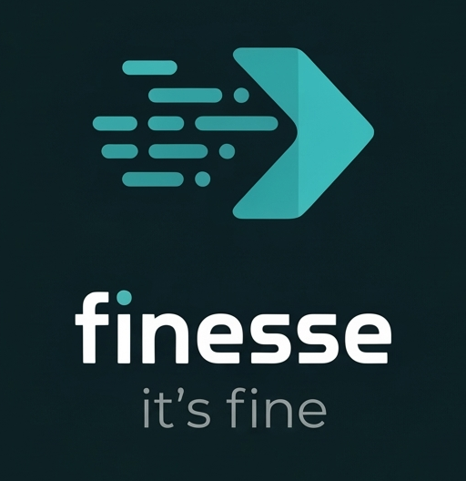

<p align="center">
  
</p>

# Finesse

Finesse replaces ActionCable's WebSocket transport with a lightweight Go binary that watches SolidCable's database (SQLite or PostgreSQL) and streams Turbo updates to browsers via Server-Sent Events (SSE). Add the gem and one line to `config/puma.rb`, and Finesse starts, restarts, and stops with your app server.

In a fan-out benchmark against ActionCable on Puma, Finesse halved delivery latency at everyday load and kept delivering every message at a load that saturated Puma ([numbers below](#why-finesse)).

## Why Finesse

ActionCable holds every WebSocket open inside your Rails server, and each message rides through the Ruby pub/sub stack. Finesse moves that fan-out work into a small Go binary that speaks plain HTTP.

### Benchmark

Rails 8 in production mode, Puma defaults (single worker, 3 threads). Both servers read the same SolidCable SQLite table, polling at 10 ms. One broadcaster stamps each message with its send time; latency is broadcast to browser receipt. Apple M1.

**Steady load** (10 broadcasts/s, 20 s windows, zero loss on both sides):

| Clients | Finesse p50 / p99 | ActionCable p50 / p99 | Finesse CPU / RSS | ActionCable CPU / RSS |
|--------:|------------------:|----------------------:|------------------:|----------------------:|
| 1       | 7 ms / 12 ms      | 9 ms / 21 ms          | 4% / 21 MB        | 13% / 163 MB          |
| 50      | 7 ms / 14 ms      | 11 ms / 28 ms         | 5% / 25 MB        | 17% / 167 MB          |
| 200     | 10 ms / 19 ms     | 19 ms / 35 ms         | 7% / 31 MB        | 24% / 172 MB          |
| 500     | 14 ms / 30 ms     | 24 ms / 42 ms         | 11% / 41 MB       | 29% / 180 MB          |

**Stress** (100 broadcasts/s to 500 clients, about 50,000 deliveries/s):

| | Finesse | ActionCable (Puma) |
|---|---:|---:|
| p50 latency | 10 ms | 5,575 ms |
| p99 latency | 16 ms | 10,206 ms |
| delivered | 100% (759k msgs) | 93.1% (428k msgs) |
| CPU / RSS | 51% / 49 MB | 97% / 325 MB |

```
p50 latency at ~50,000 deliveries/s

Finesse      ▏ 10 ms
ActionCable  ████████████████████████████████████████ 5,575 ms
```

At steady load both are lossless; Finesse halves latency and runs on a fraction of ActionCable's CPU and memory. Past Puma's ceiling, latency climbs into seconds and messages drop, while Finesse stays under 20 ms at half a core.

<details>
<summary>Methodology</summary>

- One `rails runner` loop broadcasts via `Turbo::StreamsChannel.broadcast_stream_to`, embedding an epoch-ms timestamp in each payload. Both servers poll the same `production_cable.sqlite3`.
- SolidCable's `polling_interval` was set to 0.01 s to match Finesse's default, so the comparison measures transport, not poll frequency.
- Clients: a Bun harness opening N SSE readers against Finesse or N real ActionCable WebSocket subscribers against Puma, all on one channel. Latency recorded per delivery over a 20 s window after all clients subscribed; CPU and RSS sampled from `ps` once per second.
- Caveats: clients and servers shared one machine, everything ran on localhost without TLS, and Puma used its default single worker (`WEB_CONCURRENCY` would raise its ceiling at the cost of more memory).

</details>

### Simpler on the wire

```
ActionCable                               Finesse

Browser ⇄ WS upgrade ⇄ Puma               Browser ──GET /events──> Go binary
  JSON protocol: subscribe,                 one HTTP response that
  confirm, ping/pong                        never ends (SSE frames)
  missed messages on reconnect:             reconnect + catch-up built into
  gone                                      EventSource (Last-Event-ID)
```

The server's whole job is to watch one database table and write text frames to every connection holding a valid signed token. You can watch a live stream with `curl`.

### Deployment: one line in `puma.rb`

ActionCable runs inside the Puma process and answers on Puma's port. Finesse runs as a child process that Puma starts on boot, restarts if it crashes, and stops on shutdown, the same way `plugin :solid_queue` runs Solid Queue. You don't run, supervise, or hand a signing key to anything yourself; the plugin reads the key from the booted Rails app.

One difference remains: Finesse listens on its own port (4000 by default). Browsers connect to it directly, so in production your proxy needs a route to that port (see [Production Deployment](#production-deployment)). In exchange, fan-out leaves Puma's threads and memory alone.

## Prerequisites

Finesse supports **SolidCable on SQLite or PostgreSQL (14+)**. Your Rails app needs:

- **[SolidCable](https://github.com/rails/solid_cable)** as your ActionCable adapter, with a `cable:` database configured in `config/database.yml`
- **[turbo-rails](https://github.com/hotwired/turbo-rails)** (>= 2.0) — Finesse uses Turbo's signed stream tokens for authentication

Finesse picks the backend from the cable database's `adapter` in `config/database.yml`: SQLite configs use `--db-path`, PostgreSQL configs use `--db-url`. The Puma plugin and `bundle exec finesse` resolve it the same way.

## Quick Start

1. Add to your Gemfile:
   ```ruby
   gem "finesse"
   ```

2. Install:
   ```sh
   bundle install
   ```

3. Run the generator:
   ```sh
   bin/rails g finesse:install
   ```
   It adds this line to `config/puma.rb` (once, so re-running is safe) and creates `config/initializers/finesse.rb`:
   ```ruby
   plugin :finesse
   ```

4. Point your Turbo streams at Finesse. Where a view has `turbo_stream_from @chat`, render this instead:
   ```erb
   <%= finesse_stream_from @chat %>
   ```
   It takes the same arguments as `turbo_stream_from`, so broadcasts (`broadcast_append_to @chat`, etc.) need no changes. It renders a `<finesse-stream-source>` element pointed at `http://localhost:4000` by default. In production, set `config.finesse.url` or the `FINESSE_URL` env var to your public Finesse URL.

   The generator also adds `import "finesse"` to `app/javascript/application.js`, which loads the element's JavaScript through importmap (the Rails 8 default). With jsbundling, copy `app/assets/javascripts/finesse.js` from the gem into your app and import it from your entrypoint.

5. Start your app:
   ```sh
   bin/dev
   ```

The plugin starts Finesse when Puma boots, restarts it after a crash, and stops it with Puma. In cluster mode it runs once, from the Puma master. In development it allows `http://localhost:3000`; set `FINESSE_ALLOW_ORIGIN` for anything else. If it can't start (no signing key, or no allowed origin outside development), it logs why and Puma carries on without it.

<details>
<summary>Alternative: run Finesse as its own process</summary>

Add to your `Procfile.dev`:
```
sse: bundle exec finesse --allow-origin http://localhost:3000
```
For multiple origins (e.g., accessing from another device on your network), repeat the flag:
```
sse: bundle exec finesse --allow-origin http://localhost:3000 --allow-origin http://192.168.1.10:3000
```

The wrapper derives the signing key with `rails runner` before starting the binary, so boot takes a few seconds longer.

</details>

## How It Works

```
Browser <finesse-stream-source> ──GET /events?signed_stream=…──> Finesse (Go binary, :4000)
                                                                     │
Rails app ──broadcast_append_to──> SolidCable ──INSERT──> database ←──POLL─┘
```

Finesse watches the `solid_cable_messages` table for new rows and streams them as SSE events to connected browsers. On SQLite it polls every 10ms and uses WAL mode for concurrent reads alongside Rails writes.

On PostgreSQL (`--db-url`), Finesse installs an `AFTER INSERT` trigger at boot that `pg_notify`s each new row's channel name. The matching broadcaster wakes and fetches rows at once, so delivery is near-instant; the poll ticker (default 1s) only backstops notifications missed while reconnecting. The NOTIFY payload carries only the channel name, never the message, so the 8KB NOTIFY limit does not apply. Requires PostgreSQL 14+ (`CREATE OR REPLACE TRIGGER`); if the database user cannot create triggers, Finesse logs a warning and falls back to pure polling.

Reconnecting clients send `Last-Event-ID` and get every message they missed. Recent ones come from a 200-message memory buffer per channel. Anything older, including after the last client left, after a restart, or after a long disconnect, is read back from the table (the newest 1000 rows, within SolidCable's `message_retention`).

On PostgreSQL, ids come from a sequence at insert but rows appear at commit, so a row can commit after a higher id was already delivered. Finesse notes ids below the newest one that are missing from the whole table and re-queries them for 10 seconds. A late row arrives as soon as it commits, sent without an `id:` line so the client's `Last-Event-ID` stays at the highest id and a reconnect does not replay it. Ids that never show up are rolled-back inserts and expire. A transaction held open longer than that can still be missed. SQLite has one writer and needs none of this.

Key design choices:
- **Polling with NOTIFY wakeup** — SQLite polls every 10ms; PostgreSQL rides `LISTEN/NOTIFY` with a 1s polling safety net
- **Per-channel fan-out** — each channel gets its own broadcaster with a ring buffer for reconnection catch-up, backed by the table
- **Pure Go drivers** — `modernc.org/sqlite` and `jackc/pgx` (no CGO), enabling easy cross-compilation

### Browser client

`finesse_stream_from` renders `<finesse-stream-source src="…">`, a custom element that replaces `<turbo-stream-source>`. It applies each message with Turbo's `renderStreamMessage`, so streams behave as before. It adds two things.

- **One connection per stream, not per tab.** For each `src`, the tabs race for a [Web Lock](https://developer.mozilla.org/en-US/docs/Web/API/Web_Locks_API). The winner opens the `EventSource` and relays every message to the other tabs over a `BroadcastChannel`. When it closes, another tab takes the lock and connects with `?last_event_id=` set to the last id it saw. Browsers without Web Locks or `BroadcastChannel` open one stream per element instead.
- **Back/forward cache.** An open `EventSource` keeps a page out of the bfcache. The element closes it on `pagehide` and, when the page returns from the cache (`pageshow` with `persisted`), reconnects from the last id.

## CLI Options

| Flag | Default | Description |
|------|---------|-------------|
| `--port` | `4000` | HTTP listen port |
| `--db-path` | auto from `config/database.yml` | Path to SolidCable SQLite database |
| `--db-url` | auto from `config/database.yml` | PostgreSQL connection URL or DSN (selects the PostgreSQL backend) |
| `--table-name` | `solid_cable_messages` | SolidCable messages table name |
| `--poll-interval` | `10` SQLite / `1000` PostgreSQL | Database poll interval (integer, milliseconds) |
| `--allow-origin` | *(required)* | `Access-Control-Allow-Origin` header value |
| `--heartbeat` | `20s` | Interval between `: ping` keepalive comments. `0` disables them |
| `--retry` | `2000` | Reconnect delay (milliseconds) sent to `EventSource` as `retry:` when a stream starts. `0` omits it |
| `--drain-timeout` | `25s` | On SIGTERM/SIGINT, how long open streams stay alive before they close. Browsers then reconnect and resume with `Last-Event-ID`. A second signal exits immediately |

## Environment Variables

| Variable | Description |
|----------|-------------|
| `FINESSE_SIGNING_KEY` | Hex-encoded HMAC key for signed stream verification. The Puma plugin and `bundle exec finesse` derive it from Rails when unset |
| `FINESSE_SIGNING_KEYS` | Comma-separated hex keys, all accepted for verification alongside `FINESSE_SIGNING_KEY`. Use it to rotate keys: add the new key, deploy, then retire the old one |
| `BINDING` | Bind address (default: `127.0.0.1`) |
| `FINESSE_ALLOW_ORIGIN` | Puma plugin only: comma-separated allowed origins. Defaults to `http://localhost:3000` when `RAILS_ENV`/`RACK_ENV` is development or unset; required otherwise |
| `FINESSE_URL` | Default for `config.finesse.url`, the public URL `finesse_stream_from` points browsers at (default `http://localhost:$FINESSE_PORT`) |
| `FINESSE_PORT` | Puma plugin only: listen port passed as `--port` (default `4000`) |

## Endpoints

| Path | Description |
|------|-------------|
| `GET /up` | Health check. Returns 200 with the Finesse version as the body |
| `GET /events?signed_stream=<token>` | SSE stream for the given signed stream |

The SSE endpoint supports the `Last-Event-ID` header and replays missed messages on reconnect. `EventSource` can't set that header on a new connection, so `GET /events?signed_stream=<token>&last_event_id=<id>` does the same; the header wins when both are present. Stream tokens use the same `ActiveSupport::MessageVerifier` format as Turbo's signed streams. Both endpoints set an `X-Finesse-Version` header.

## Development

### Compiling from source

Requires Go 1.26+.

```sh
bundle exec rake build:local   # Build for current platform
bundle exec rake build:all     # Cross-compile for all platforms
```

### Running tests

All build and test commands should be run via `bundle exec`:

```sh
bundle exec rake test          # Run Go + Ruby tests
bundle exec rake test:go       # Go tests only
bundle exec rake test:ruby     # Ruby tests only
```

The PostgreSQL integration test runs only when `FINESSE_TEST_PG_URL` points at a PostgreSQL 14+ database, e.g. `FINESSE_TEST_PG_URL="dbname=finesse_test" bundle exec rake test:go`.

### Running locally

```sh
FINESSE_SIGNING_KEY=<hex> ./exe/arm64-darwin/finesse --allow-origin http://localhost:3000 \
  --db-path ../your-app/storage/development_cable.sqlite3
```

## Security

Finesse verifies every SSE connection using Turbo's signed stream tokens (HMAC-SHA256). CORS is restricted to the origins you specify with `--allow-origin`, and the server binds to `127.0.0.1` by default.

### Signing Key Flow

**TL;DR:** Finesse needs the same HMAC key that Turbo uses to sign stream names. The Puma plugin reads it from the booted Rails app and passes it to the binary. No setup.

The problem: Finesse is a standalone Go binary, but it needs to verify tokens that Rails signs. Rails derives its signing key from `SECRET_KEY_BASE` via PBKDF2, and that secret lives in encrypted credentials (`config/credentials.yml.enc`) which require Ruby's `Marshal` deserializer to read. Reimplementing that in Go would be fragile and version-dependent.

The solution: let Ruby do the Ruby parts, then hand the result to Go.

```
        Rails Boot                           Finesse Boot (Puma plugin)
        ──────────                           ──────────────────────────

config/credentials.yml.enc           plugin :finesse, inside booted Rails
           │                                    │
           ▼                                    ▼
      SECRET_KEY_BASE                Finesse.signing_key
           │                                    │
           ▼                                    ▼
      PBKDF2-HMAC-SHA256             Turbo.signed_stream_verifier_key
      salt: "turbo/signed_                      │
            stream_verifier_key"                ▼
      iterations: 65,536             hex-encode the derived key
      output: 64 bytes                          │
           │                                    ▼
           ▼                         spawn(go_binary) with
      Turbo.signed_stream_             FINESSE_SIGNING_KEY=hex
        verifier_key                            │
           │                                    ▼
           ▼                           ├── reads env, decodes hex
      turbo_stream_from @chat          └── verifies HMAC on every
      signs channel name ─────────▶  /events?signed_stream=<token>
```

**Token format** (Rails `ActiveSupport::MessageVerifier`):
```
base64strict(json(channel_name))--hex(hmac_sha256(base64_data, derived_key))
```

The Go binary splits the token on `--`, recomputes the HMAC over the base64 data, and compares using constant-time `hmac.Equal`. If it matches, the channel name is trusted.

**Without the plugin**, `bundle exec finesse` gets the same key by running `rails runner "print Finesse.signing_key"` before it execs the binary. That boots Rails once per start, so in production set `FINESSE_SIGNING_KEY` as a hex-encoded env var to skip it. Either way, development needs no setup: Rails keeps `secret_key_base` in `tmp/local_secret.txt`.

## Production Deployment

Finesse binds to `127.0.0.1` by default and should **not** be exposed directly on port 80/443. With the Puma plugin it runs next to Puma on the same host; set `FINESSE_ALLOW_ORIGIN` to your production origin (the plugin won't start without it outside development) and proxy a path to it from your web server. For example, with Nginx:

```nginx
upstream finesse {
  server 127.0.0.1:4000;
}

location /finesse/ {
  proxy_pass http://finesse/;
  proxy_set_header Host $host;
  proxy_set_header X-Forwarded-For $proxy_add_x_forwarded_for;

  # SSE requires unbuffered responses
  proxy_buffering off;
  proxy_cache off;
  # Finesse pings every 20s, so a short timeout is safe and frees dead connections
  proxy_read_timeout 75s;
}
```

Browsers allow only 6 HTTP/1.1 connections per origin, and each open tab holds one for its stream. Serve the SSE hostname over HTTP/2 at the proxy so tabs share one connection ([MDN: EventSource](https://developer.mozilla.org/en-US/docs/Web/API/EventSource)). In nginx that means `listen 443 ssl; http2 on;` on the server block. kamal-proxy enables HTTP/2 automatically when it terminates TLS.

### systemd

To run Finesse as its own service, generate a unit file:

```sh
bin/rails g finesse:systemd --origin https://yourapp.com --user deploy
```

This writes `config/finesse.service`, which runs `bundle exec finesse --allow-origin <origin>` from your app root and restarts it on failure. Copy it to `/etc/systemd/system/` and run `systemctl enable --now finesse`. Set `FINESSE_SIGNING_KEY` in the unit to skip the `rails runner` boot.

### Kamal

If you deploy with [Kamal](https://kamal-deploy.org), run Finesse as its own server role in `config/deploy.yml`. kamal-proxy forwards each role's container to a single `app_port`, so it cannot reach a Finesse started by the plugin inside the web container. kamal-proxy detects `Content-Type: text/event-stream` responses and disables buffering, so the role needs no extra proxy configuration.

```yaml
servers:
  web:
    - <your-public-server-ip>
  sse:
    hosts:
      - <your-public-server-ip>
    cmd: bundle exec finesse --allow-origin "https://yourapp.com"
    env:
      clear:
        BINDING: 0.0.0.0
    proxy:
      ssl: true
      host: sse.yourapp.com
      app_port: 4000
      healthcheck:
        path: /up
```

Point a DNS record for `sse.yourapp.com` at your server and kamal-proxy handles TLS and routing.

Set `FINESSE_SIGNING_KEY` as a hex-encoded env var to avoid a `rails runner` invocation on every boot. The `--allow-origin` flag should match your production domain.

If `config/puma.rb` has `plugin :finesse`, the web role's Puma will also try to start Finesse. Without `FINESSE_ALLOW_ORIGIN` it logs a line and skips, but if you set that variable in Kamal's top-level `env` (which every role inherits) you get a second, unreachable copy. Guard the plugin the way Rails 8's generated `puma.rb` guards Solid Queue:

```ruby
plugin :finesse if ENV["FINESSE_IN_PUMA"]
```

Set `FINESSE_IN_PUMA=1` in development and leave it unset in production.

## Roadmap

- **Rails generator**: `rails g finesse:install` to add the plugin line and allowed origins
- **View helper**: `finesse_stream_from @chat` to replace the hand-built `turbo-stream-source` tag in Quick Start
- **Server features**: heartbeats, `retry:`, clean drain on deploy, and table-backed replay, from [docs/realtime-horizon.md](docs/realtime-horizon.md) and [docs/deployment-qol.md](docs/deployment-qol.md)

## License

MIT License. See [LICENSE](LICENSE) for details.
